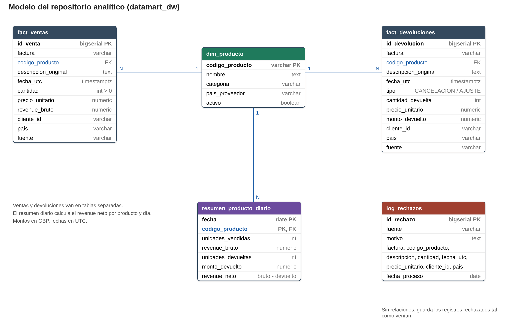

# Pipeline ETL DataMart con Apache Airflow

Pipeline que lleva las ventas de DataMart S.A.S. desde dos archivos CSV y una API de productos hasta un
repositorio analítico en PostgreSQL, orquestado con Apache Airflow y todo dentro de Docker.

- Decisiones técnicas y casos ambiguos: [docs/decisiones_tecnicas.md](docs/decisiones_tecnicas.md)
- Diagrama del modelo de datos: [docs/diagrama_modelo.png](docs/diagrama_modelo.png)
- Exploración de los datos: [notebooks/01_exploracion.ipynb](notebooks/01_exploracion.ipynb)
- Consultas de negocio: [sql/consultas/](sql/consultas/) y [notebooks/02_consultas_negocio.ipynb](notebooks/02_consultas_negocio.ipynb)

## Requisitos

- Docker con Docker Compose 2.24 o superior (Docker Desktop actual ya lo incluye).
- Los puertos 8080, 8081, 8888 y 8000 libres.

No hace falta instalar nada más: Python, pandas, Airflow, PostgreSQL y Jupyter corren dentro de los contenedores.

## Cómo levantarlo

```bash
git clone https://github.com/inghabith/Prueba_de_desempe-o_RA.git
cd Prueba_de_desempe-o_RA
docker compose up -d
```

Con eso basta. No hay que copiar el `.env`: el compose usa `.env.example` y, si existe un `.env`, toma sus
valores primero. La primera vez tarda unos minutos mientras descarga las imágenes.

Al iniciar, de forma automática:
1. Se crean las dos bases PostgreSQL (metadatos de Airflow y repositorio analítico) y las tablas del repositorio.
2. `airflow-init` crea el usuario administrador, las Connections y las Variables, y termina.
3. El scheduler detecta el DAG `datamart_etl`, que ya está activo, y lo ejecuta. Tarda alrededor de 1 minuto.

| Servicio | Dirección | Acceso |
|---|---|---|
| Airflow | http://localhost:8080 | usuario `admin`, contraseña `admin` |
| Jupyter | http://localhost:8888 | sin contraseña |
| API de productos | http://localhost:8000/docs | sin contraseña |
| Adminer (ver la base) | http://localhost:8081/?pgsql=postgres-dw&username=datamart&db=datamart_dw | contraseña `datamart_pass` |
| Adminer (metadatos de Airflow) | http://localhost:8081/?pgsql=postgres-airflow&username=datamart&db=airflow | contraseña `datamart_pass` |

## Cómo verificar que funcionó

1. **El DAG corrió:** en http://localhost:8080 entra al DAG `datamart_etl`. La ejecución y sus 6 tareas deben
   estar en verde (success).
2. **Connections:** en *Admin → Connections* deben aparecer `dw_postgres` (PostgreSQL) y `api_productos` (HTTP).
3. **Variables:** en *Admin → Variables* deben aparecer `ruta_datos`, `zona_horaria_origen` y `tamano_pagina_api`.
4. **Los datos llegaron:** en http://localhost:8888 abre `notebooks/02_consultas_negocio.ipynb` y ejecútalo
   (*Run → Run All Cells*). Muestra el resultado de las consultas de cada pregunta de negocio sobre el repositorio
   analítico.
5. **Las tablas:** abre el enlace "Adminer (ver la base)" de la tabla anterior y escribe la contraseña `datamart_pass`. Se ven
   las tablas del repositorio analítico; en cada una, *Select data* muestra sus filas y *SQL command* permite
   ejecutar consultas.
6. **La API responde:** en http://localhost:8000/docs prueba `GET /productos` y `GET /productos/85123A`.

Si prefieres la terminal, estos comandos hacen las mismas verificaciones:

```bash
docker compose exec airflow-scheduler airflow dags list-runs -d datamart_etl
docker compose exec airflow-scheduler airflow connections list
docker compose exec airflow-scheduler airflow variables list
docker compose exec postgres-dw psql -U datamart -d datamart_dw -c "SELECT COUNT(*) FROM fact_ventas;"
```

Resultado esperado: 522.504 ventas, 9.992 devoluciones, 545.763 rechazos y 3.911 productos.

## Modelo de datos

Repositorio analítico en modelo estrella: `dim_producto` al centro, las ventas y las devoluciones separadas en
dos tablas de hechos, un resumen diario con el revenue bruto y neto, y el log de rechazos. La justificación está
en [docs/decisiones_tecnicas.md](docs/decisiones_tecnicas.md).



## Pipeline (DAG `datamart_etl`)

```
extraer_ventas_diarias ─┐
extraer_historico ──────┼─> transformar ─> validar_calidad ─> cargar_repositorio
extraer_catalogo_api ───┘
```

- **Programación:** diaria (`@daily`), sin catchup, con 2 reintentos automáticos (1 minuto entre intentos).
- **Connections:** `dw_postgres` (repositorio analítico) y `api_productos` (API de productos).
- **Variables:** `ruta_datos`, `zona_horaria_origen` y `tamano_pagina_api`.
- **Idempotente:** la carga vacía y vuelve a llenar las tablas en una sola transacción, y `fecha_proceso` es la
  fecha lógica del DAG. Ejecutarlo dos veces el mismo día deja exactamente los mismos datos (verificado con un
  hash de cada tabla).

## Calidad de datos y reglas de negocio

Todo se hace con pandas en `dags/etl/transformacion.py`. Los valores que se pueden cambiar (formatos, patrón de
código, valores por defecto y motivos de rechazo) están en `dags/etl/config.py`.

- Códigos de producto en mayúsculas y sin espacios; fechas convertidas de Europe/London a UTC.
- Cantidad menor o igual a cero: va a `fact_devoluciones` (CANCELACION si la factura empieza con C, si no AJUSTE),
  separada de las ventas.
- Revenue bruto = cantidad x precio. Revenue neto = bruto menos devoluciones del mismo producto el mismo día
  (`resumen_producto_diario`).
- Se rechazan con su motivo y su fuente en `log_rechazos`: duplicados exactos, duplicados entre fuentes, fechas
  inconsistentes, códigos que no son productos y ventas con precio menor o igual a cero.
- Antes de cargar, `validar_calidad` revisa, entre otras cosas, que cada fila de entrada termine en ventas,
  devoluciones o rechazos (1.078.259 = 522.504 + 9.992 + 545.763) y que revenue neto = bruto - devoluciones.

## Decisiones principales

Resumen de [docs/decisiones_tecnicas.md](docs/decisiones_tecnicas.md), donde está cada una con sus números:

- **Transacciones sin customer ID (24,9%):** se incluyen con el cliente `DESCONOCIDO` para no perder ~1,5 millones
  de GBP en ventas; la pregunta 5 compara su comportamiento con el de los clientes identificados.
- **Varias descripciones por código:** el nombre canónico es la descripción normalizada más frecuente (en empate,
  la primera en orden alfabético).
- **Duplicados entre fuentes:** el histórico trae las mismas facturas de la fuente diaria con fechas corridas
  8 años y precios alterados. Es duplicada la línea con la misma factura y el mismo producto, y gana la fuente
  diaria. Las que quedan tienen fechas posteriores a la fuente diaria y se rechazan como inconsistentes.
- **Modelo estrella:** pocas tablas y un solo JOIN para responder las preguntas de negocio, con ventas y
  devoluciones en tablas de hechos separadas.

## Consultas SQL de validación

Una por cada pregunta del enunciado, en `sql/consultas/`. Se pueden ejecutar en Adminer (*SQL command*) o ver sus
resultados en `notebooks/02_consultas_negocio.ipynb`.

| Pregunta | Archivo |
|---|---|
| 1. Evolución mensual de las ventas netas | `01_evolucion_mensual_ventas_netas.sql` |
| 2. Categorías: revenue bruto y proporción de devoluciones | `02_categorias_revenue_y_devoluciones.sql` |
| 3. Top 10 por revenue neto y por tasa de devolución | `03a_top10_productos_revenue_neto.sql`, `03b_top10_productos_tasa_devolucion.sql` |
| 4. Países: transacciones y ticket promedio | `04_paises_transacciones_ticket.sql` |
| 5. Clientes identificados vs. sin customer ID | `05_clientes_identificados_vs_desconocidos.sql` |
| 6. Descripciones inconsistentes y códigos únicos | `06_descripciones_inconsistentes.sql` |
| 7. Recomendación para el equipo de producto | `07_recomendacion_producto.sql` |

## Estructura del proyecto

```
docker-compose.yml          servicios del entorno
.env.example                variables de entorno (el .env real está en .gitignore)
airflow/init_airflow.sh     crea el usuario admin, las Connections y las Variables al iniciar
api/                        API de productos (FastAPI)
jupyter/Dockerfile          imagen de Jupyter con pandas
dags/
  datamart_etl_dag.py       el DAG: solo define las tareas y su orden
  etl/
    config.py               mapeo de columnas, formatos de fecha y motivos de rechazo
    extraccion.py           lectura de los CSV y de la API
    transformacion.py       limpieza y reglas de negocio con pandas
    calidad.py              validaciones antes de cargar
    carga.py                carga idempotente a PostgreSQL
data/
  raw/                      los dos CSV de Kaggle, comprimidos
  catalogo/productos.csv    catálogo que sirve la API (y respaldo si la API no responde)
scripts/generar_catalogo.py cómo se generó el catálogo
sql/
  ddl/01_crear_tablas.sql   tablas del repositorio analítico (se ejecuta al iniciar)
  consultas/                una consulta por cada pregunta de negocio
notebooks/
  01_exploracion.ipynb      exploración de las fuentes y decisiones de calidad
  02_consultas_negocio.ipynb resultados de las preguntas de negocio
docs/
  decisiones_tecnicas.md    diseño, casos ambiguos e idempotencia
  diagrama_modelo.png       diagrama del modelo de datos
  modelo_datos.dbml         el mismo modelo para pegar en dbdiagram.io
```

## Fuentes de datos

| Archivo en el repo | Origen |
|---|---|
| `data/raw/ventas_diarias.csv.gz` | Kaggle `carrie1/ecommerce-data`, archivo `data.csv` (volcado diario) |
| `data/raw/historico_ventas.csv.gz` | Kaggle, archivo `Sales Transaction v.4a.csv` (historial) |

Los archivos están comprimidos con gzip para que el repositorio sea liviano; pandas los lee directamente.

## Volver a ejecutar o empezar de cero

- **Ejecutar el DAG otra vez:** botón *Trigger DAG* en la interfaz de Airflow. Como el DAG es idempotente,
  las tablas quedan con los mismos datos; solo cambia `fecha_proceso` en `log_rechazos` si la ejecución
  corresponde a otro día.
- **Borrar todo y empezar de cero:** `docker compose down -v` y luego `docker compose up -d`.
